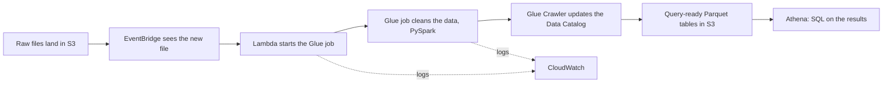

# Serverless Data Pipeline on AWS

My MSc dissertation project (Big Data Management & Analytics, Griffith College, 2026).

An event-driven pipeline that takes raw files from the Olist Brazilian e-commerce dataset, dropped into S3, and
turns them into tables ready for querying, with no manual steps.

## How it works

1. **S3** holds the raw files and the cleaned output.
2. **EventBridge** reacts as soon as a new file arrives.
3. **Lambda** checks the event and starts the Glue job.
4. **Glue** (PySpark) cleans the data, removes duplicates and writes Parquet tables; a **Glue Crawler** registers
   them in the Data Catalog.
5. **Athena** runs SQL on the result.
6. **IAM** roles give each service only the access it needs.
7. **CloudWatch** logs were where I traced failures back to the cause.

## Result

The output was checked against the source before calling it done: **75,310 orders across 7 tables, with no
duplicates.**

## Status

The code, setup and Athena queries are being added to this repository.
