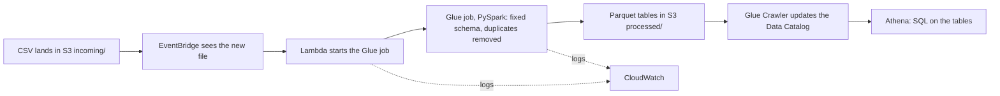

# Serverless Data Pipeline on AWS

My MSc dissertation project (Big Data Management & Analytics, Griffith College, 2026).

An event-driven pipeline that takes the Olist Brazilian e-commerce files, dropped into S3, and turns them into
Parquet tables ready for SQL, with no manual steps.

## How it works



1. **S3** holds the incoming files, the Parquet output and the Athena results.
2. **EventBridge** reacts as soon as a new file arrives under `incoming/`.
3. **Lambda** checks the file is one of the 7 tables and starts the Glue job.
4. **Glue** (PySpark) reads each table with a fixed schema, drops duplicate rows and writes Parquet to `processed/`.
5. A **Glue Crawler** runs when the job succeeds and registers the tables in the Data Catalog.
6. **Athena** runs SQL on the result.
7. **IAM** roles give each service only the access it needs.
8. **CloudWatch** logs were where I traced failures back to the cause.

## What is in this repo

```
glue/incoming_to_processed.py   The Glue job
glue/earlier/olist_etl_job.py   Another Glue script from the project (see below)
src/trigger/app.py              The Lambda that starts the job
template.yaml                   Everything above as code (AWS SAM / CloudFormation)
sql/athena_checks.sql           Row counts, duplicate and missing-key checks
tests/                          Unit tests, no AWS account needed
Makefile                        install, lint, test, deploy, run
```

## What is original and what I recreated

**The two Glue scripts are from the dissertation project.** In `incoming_to_processed.py` the only change is that the
bucket name comes in as a job argument instead of being written in the script. In `earlier/olist_etl_job.py` I only
removed my bucket name. That second script partitions orders by year and month and does not remove duplicates, so the
pipeline uses the first one.

**The Lambda, the EventBridge rule, the crawler, the IAM roles and the SQL checks were recreated.** I built them in my
AWS account for the dissertation, and later they were removed from it. They are written here from the same
design, as code, so they can be deployed again. The template has not been deployed yet, so the first deploy is the real
test. I used Claude, an AI assistant, to help write the template, the tests and the checks.

## Result

When I ran the project, the output was checked against the source before I called it done: **75,310 orders across 7
tables, with no duplicates.** `sql/athena_checks.sql` is the set of checks for repeating that.

## Deploy it

You need an AWS account, the [AWS SAM CLI](https://docs.aws.amazon.com/serverless-application-model/latest/developerguide/install-sam-cli.html)
and the AWS CLI with credentials set up on your machine.

```bash
make deploy          # creates the bucket, Lambda, Glue job, crawler, roles and Athena workgroup
make upload-script   # puts the Glue script in the bucket the stack created
```

Then upload the Olist CSV files to `incoming/<table>/` in that bucket, for example `incoming/orders/orders.csv`.
The 7 table folders are `customers`, `orders`, `order_items`, `payments`, `products`, `reviews` and `sellers`.
The job runs by itself, the crawler follows it, and the tables appear in the `olist` database in Athena.
To start the job without a new file, run `make run`.

The Olist dataset is on [Kaggle](https://www.kaggle.com/datasets/olistbr/brazilian-ecommerce). It is not in this repo.

## Checking the code

```bash
make install
make check           # ruff, cfn-lint and the tests
```

The tests do not need AWS or Spark. They check that the Lambda only starts the job for the right files, and that the
template, the Glue script and the SQL agree on the same tables and folders. They also check that no role uses a wildcard
and that no account ID or key is in the repo. The same checks run on every push in GitHub Actions.

## Limits

- The job runs one at a time. If a file arrives while it is running, Lambda tries again twice. After that, run
  `make run` or upload the file again.
- The job reads CSVs as written in the script: no header row, columns in the order of the schemas, with a `date`
  column last.
- Each run rewrites the whole `processed/` folder.
- No cost alarms or failure alerts are set up. Only CloudWatch logs.
